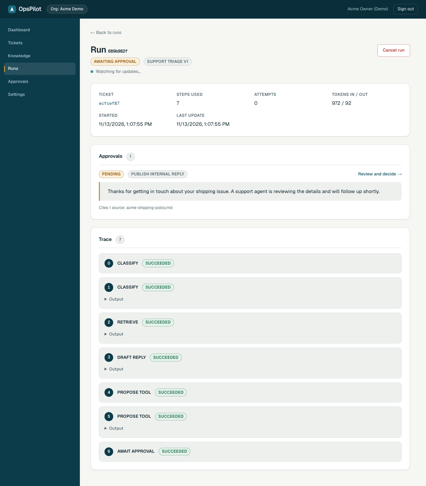
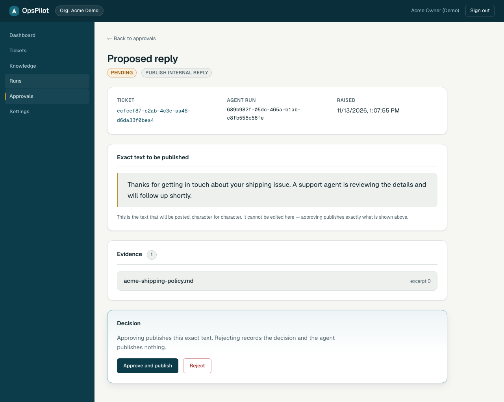
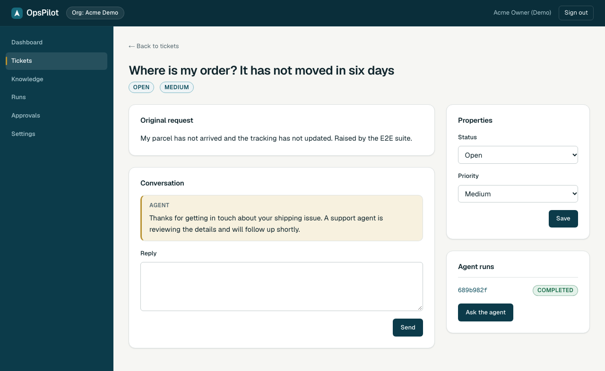
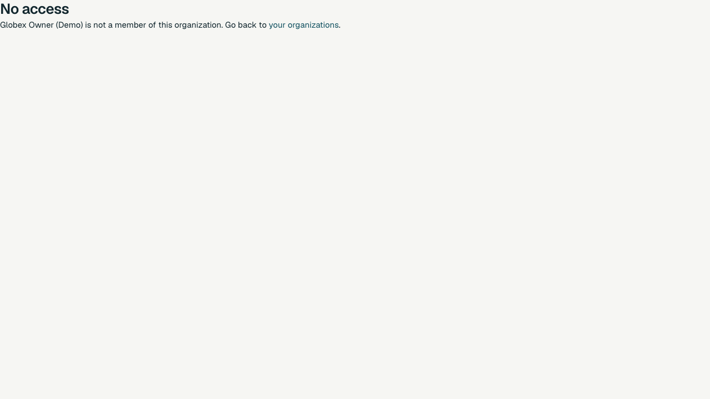
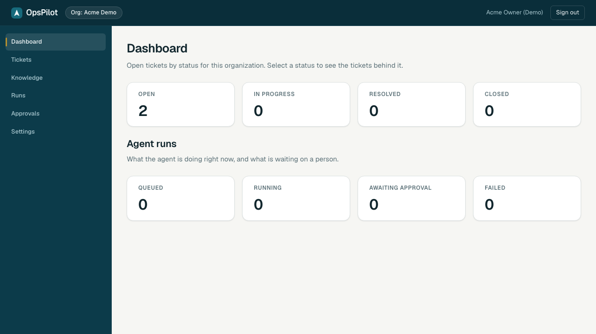
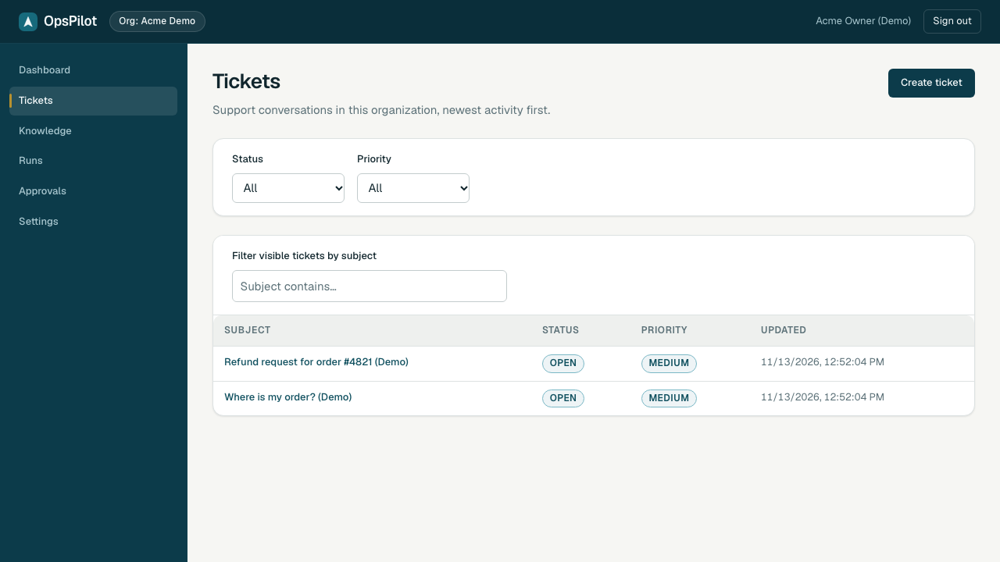
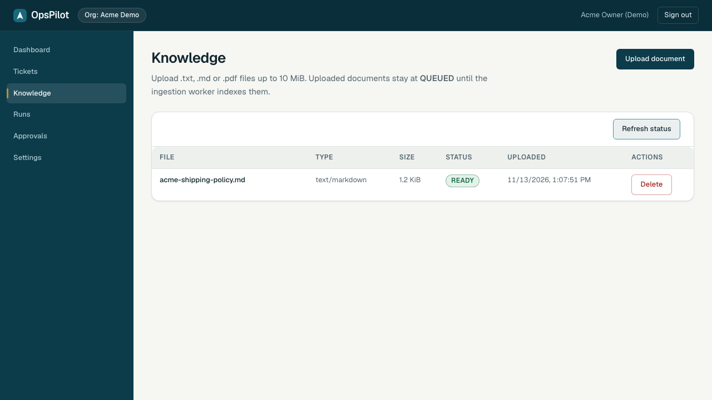
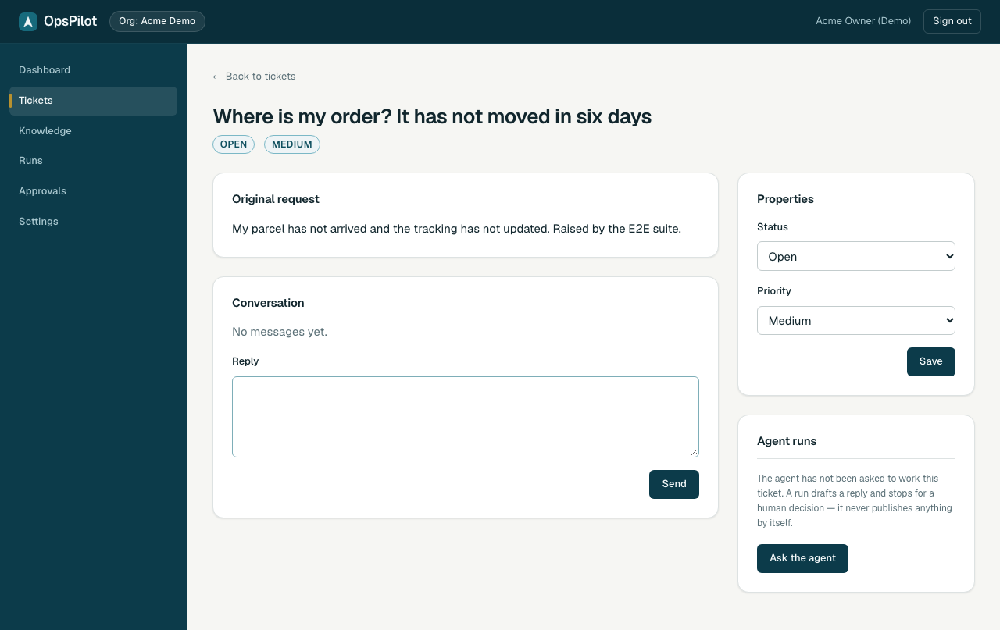
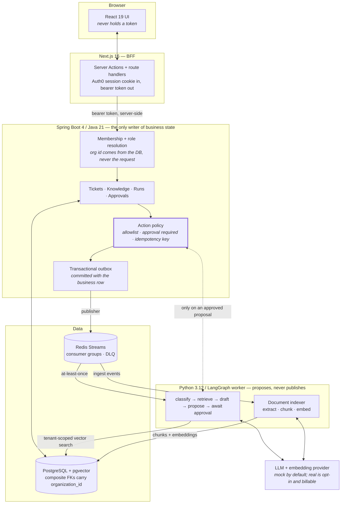

# OpsPilot

**An AI agent that drafts support replies, and cannot send them.** A multi-tenant support desk
where the agent reads a ticket, retrieves that company's own knowledge, and proposes a cited
reply — and a human approves the exact text or nothing is published.

[](https://github.com/abram0102/OpsPilot-AI-Native-Workflow-Automation-Platform/actions/workflows/ci.yml)

> **Not deployed.** This runs locally and has never been applied to a cloud account, so there is
> no demo URL. The AWS infrastructure is written and statically validated but never run; the
> [Limitations](#limitations-and-tradeoffs) section says exactly what that costs in evidence.
> Every number on this page links to the file that measured it.

---

## What it looks like

The agent has finished and stopped. It classified the ticket, retrieved from this tenant's
knowledge base, drafted a reply with a citation — and the run sits at `AWAITING_APPROVAL`, which
is as far as it is permitted to go.



A human reads the proposal and decides. Approving publishes **that** text, once.





The other tenant, holding a valid session and a correct URL, gets nothing:



<details>
<summary>The rest of the product — dashboard, ticket queue, knowledge ingestion</summary>






</details>

All eight images are **regenerated by a test** — `make screenshots` drives the real stack with
Playwright and overwrites them ([`tests/e2e/tests/screenshots.spec.ts`](tests/e2e/tests/screenshots.spec.ts)).
A feature that breaks cannot keep a working-looking picture. The data is fictional throughout; see
[Synthetic data](docs/DEMO_SCRIPT.md#synthetic-data).

## The idea

Most "AI agent" demos are impressive because the agent acts. This one is built around the opposite
constraint: **an LLM's proposed tool call is not authorization.** The interesting engineering is
in the machinery that makes that true under failure —

- the agent worker has no write access to business tables; every effect goes back through the API,
  which re-checks role, tenant, allowlist and approval state from scratch;
- an approval decides one immutable proposal, so the published text is the text a human read;
- effects are keyed `(run_id, tool_call_id)`, so an at-least-once queue cannot publish twice;
- and a worker killed mid-action converges on exactly one visible effect — [drilled, not assumed](docs/FAILURE_DRILLS.md#drill-3--worker-killed-mid-action).

## Architecture



Three properties the picture is drawn to make visible:

1. **The browser never holds an access token.** The Next.js BFF keeps the session and forwards a
   bearer token server-side.
2. **Tenant isolation is enforced twice** — in application-level membership checks and in composite
   foreign keys that carry `organization_id` into every child row, so a bug in one layer cannot
   leak another organization's data on its own.
3. **The dashed arrow is the product.** The worker's path back to a user-visible write runs through
   the policy gate, which re-validates everything, including that a human approved this exact
   proposal.

Full specification: [`docs/PRODUCT_AND_ARCHITECTURE.md`](docs/PRODUCT_AND_ARCHITECTURE.md) ·
HTTP and event contracts: [`docs/API_CONTRACT.md`](docs/API_CONTRACT.md) · generated OpenAPI:
[`packages/contracts/openapi.json`](packages/contracts/openapi.json) (CI fails on drift).

## Run it

Four minutes from a clean checkout, no API key, no cloud account:

```bash
cp .env.example .env && make infra-up && make seed-demo
```

Then `make api-dev`, `make worker-dev` and `make web-dev` in three terminals, and sign in at
<http://localhost:3000>. `AI_MODE=mock` is the default and calls no provider — which is also why
the screenshots and the evaluation are reproducible.

The guided version, with what to click and what to say about it, is
[`docs/DEMO_SCRIPT.md`](docs/DEMO_SCRIPT.md). Without Docker, point `POSTGRES_*` and `REDIS_URL`
at your own PostgreSQL 17 (plus the `vector` extension) and Redis; this repository was developed
that way.

## Evidence

Everything below is a measurement with a file behind it. Nothing is estimated.

| Claim | Measured | Evidence |
|---|---|---|
| Ticket list p95 under load | **149.93 ms → 36.91 ms** (−75%), throughput 1,264 → 4,646 req/s | [benchmark report](benchmarks/2026-11-13-report.md#load-test-before-and-after) |
| The query fix behind it | Row-value cursor: **108× faster**, 5,000× fewer buffers, with both `EXPLAIN` plans | [query plans](benchmarks/2026-11-13-report.md#2-a-row-value-cursor-predicate-ticketrepositoryfindpageafternative) |
| Agent safety, 60 fictional cases | **0 forbidden actions executed**, 100% approval-required recall, 88.0% classification accuracy | [`evals/reports/`](evals/reports) |
| Worker `kill -9` mid-action | 0 messages before, **exactly 1** after restart, still 1 fifteen seconds later | [drill 3](docs/FAILURE_DRILLS.md#drill-3--worker-killed-mid-action) |
| Readiness probe with the database down | 30,016 ms → **2,041 ms** (a real defect the drill found) | [drill 1](docs/FAILURE_DRILLS.md#drill-1--database-unavailable) |
| Threat model is not prose | Every mitigation names a test; **CI fails if one is renamed** | [`docs/THREAT_MODEL.md`](docs/THREAT_MODEL.md), [`scripts/check-threat-model.py`](scripts/check-threat-model.py) |

Test suites, all runnable offline against mock AI:

```bash
make check
```

| Suite | Command | Covers |
|---|---|---|
| Java | `make test-integration` | Real PostgreSQL via Testcontainers: tenant isolation, state machines, stale writes, replay, idempotency under ten concurrent duplicates |
| Python | `cd services/agent && uv run pytest` | Graph nodes, checkpoint resume, stream consumer, dead-letter, indexer |
| Web | `cd apps/web && pnpm test` | Server actions, forms, access-denied rendering |
| E2E | `make test-e2e` | Playwright over the real stack: login, ticket, agent run, approval, publication, knowledge ingestion, cross-tenant refusal, and an axe accessibility pass |
| Security | `make test-security` | Every mapped route enumerated and probed unauthenticated and cross-tenant |
| Evaluation | `make eval-mock` | 60-case triage dataset, including 10 adversarial |

## Limitations and tradeoffs

Stated plainly, because a portfolio project that hides these is less interesting than one that
names them.

**Not done.**

- **Nothing is deployed.** `infra/aws/` is written, formatted, validated and linted, and has
  **never been applied** — no `plan`, no `apply`, no AWS account. Everything it claims about
  staging is unverified. ([`infra/aws/README.md`](infra/aws/README.md))
- **No real model has ever been called.** The default is a deterministic mock, and that is the
  only provider this system has ever run against. The OpenAI-compatible adapter is written and
  verified offline against a mocked transport — request shaping, usage parsing, error mapping,
  cost arithmetic — but `make eval-real` refuses until Gate H2 is opened, and it never has been.
  The 60-case evaluation therefore measures the mock and the prompt scaffolding around it, not a
  model's judgement.
- **Backup and restore is written, never tested.** The procedure exists; no restore has been
  performed. ([`docs/FAILURE_DRILLS.md`](docs/FAILURE_DRILLS.md#backup-and-restore--written-never-tested))
- **The failure drills killed local processes**, not cloud infrastructure. RDS failover,
  ElastiCache failover and ALB behaviour are untested.

**Deliberate tradeoffs.**

- **Exact vector search, no HNSW index.** At demo data volumes a sequential scan is faster than an
  approximate index and has perfect recall. It is also the most likely next bottleneck, and it is
  unbenchmarked — the honest statement is "not measured", not "fast enough".
- **Benchmarks are laptop benchmarks.** The load generator shares a machine with the API and the
  database. Use the numbers to compare this system against itself, not as a capacity estimate.
- **Redis Streams, not Kafka. Fargate, not Kubernetes.** One repository, four deployables. The
  reliability properties that matter here — at-least-once delivery with idempotent effects — are
  achievable with far less machinery, and the outbox is what makes them true.
- **Spring for business state, Python for the agent.** The split is a boundary, not a preference:
  the worker runs in the ecosystem where the agent tooling lives, and is denied write access to the
  tables that matter.
- **An approval is required even when the agent is right.** This makes the product slower and is
  the point.

## Repository layout

```
apps/web/           Next.js 16 / React 19 / TypeScript frontend and BFF
services/api/       Spring Boot 4 / Java 21 — business API, authorization, outbox
services/agent/     Python 3.12 / LangGraph worker — triage graph and document indexer
packages/contracts/ OpenAPI spec generated from the running API + typed TS client
infra/              docker-compose for local dev; infra/aws/ OpenTofu (never applied)
docs/               Product, architecture, security, threat model, drills, decisions
evals/              Evaluation dataset and reports
benchmarks/         k6 profile, fixture and measured reports
tests/e2e/          Playwright suite, including the screenshot capture
```

## Documentation

| File | Contents |
|---|---|
| [`docs/DEMO_SCRIPT.md`](docs/DEMO_SCRIPT.md) | The four-minute demo, with the real commands |
| [`docs/PRODUCT_AND_ARCHITECTURE.md`](docs/PRODUCT_AND_ARCHITECTURE.md) | PRD, user flows, module boundaries |
| [`docs/DATA_MODEL.md`](docs/DATA_MODEL.md) | Schema, constraints, state machines |
| [`docs/API_CONTRACT.md`](docs/API_CONTRACT.md) | HTTP, event and agent-tool contracts |
| [`docs/SECURITY_AND_TESTING.md`](docs/SECURITY_AND_TESTING.md) | Threat model, mandatory tests, CI gates |
| [`docs/THREAT_MODEL.md`](docs/THREAT_MODEL.md) | Each threat, its mitigation, and the test that holds it |
| [`docs/OBSERVABILITY.md`](docs/OBSERVABILITY.md) | Metrics, alert thresholds, and what is not measured |
| [`docs/FAILURE_DRILLS.md`](docs/FAILURE_DRILLS.md) | What happened when dependencies were killed |
| [`benchmarks/2026-11-13-report.md`](benchmarks/2026-11-13-report.md) | Load test, query plans and their limits |
| [`infra/aws/README.md`](infra/aws/README.md) | The AWS deployment and its gate — never applied |
| [`docs/RELEASE_REPORT.md`](docs/RELEASE_REPORT.md) | Final audit: per-criterion verdicts, known issues by severity, 30-day plan |
| [`docs/DECISIONS.md`](docs/DECISIONS.md) | Architecture decision records |
| [`docs/PROGRESS.md`](docs/PROGRESS.md) | Per-ticket status and evidence (source of truth) |

## Project status

Built one reviewed ticket at a time from a 36-ticket backlog, each with its own tests and recorded
evidence. T00–T30, T34 and T35 are complete and CI-verified. T31–T33 (AWS infrastructure, deployment
pipeline, failure drills) are partial by design: the code is written and the drills that could be
run locally were run, but everything requiring a cloud account is gated on an explicit human
approval that has not been given. [`docs/PROGRESS.md`](docs/PROGRESS.md) records what was actually
run for each ticket, including what failed first.

## License

No license has been selected yet (see [`docs/DECISIONS.md`](docs/DECISIONS.md), ADR-006). Until one
is added, all rights are reserved by the owner.
